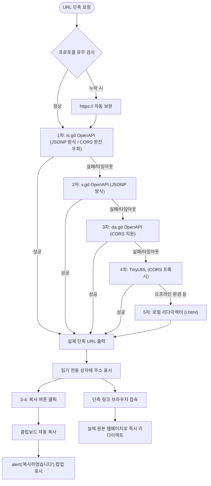

# 📋 프로젝트 개요 및 기능 명세서

## 1. 프로젝트 개요 (Project Overview)

- **프로젝트명**: Link & QR Studio (QR코드 생성 및 URL 단축 올인원 웹 애플리케이션)
- **개발 환경**: 순수 프론트엔드 웹 기술 (Pure Vanilla HTML5 / CSS3 / JavaScript ES6+)
- **주요 목적**:
  1. 복잡하고 긴 웹 링크를 빠르고 간결하게 압축하는 **URL 단축(Shortener)** 기능 제공
  2. 어떤 웹 링크든 스캔 가능한 고해상도 코드로 변환하고 JPG로 내려받을 수 있는 **QR코드 생성(URL2QR)** 기능 제공
  3. 두 핵심 도구를 원클릭으로 오갈 수 있는 직관적인 **통합 허브 및 내비게이션** 구축

---

## 2. 프로젝트 디렉토리 구조

```text
프로젝트06/
├── index.html                   # [신규] 메인 포털 허브 (QR코드 및 URL단축 연결 대시보드)
├── SPECIFICATION.md             # [신규] 프로젝트 개요 및 기능 명세서
│
├── url2qr/                      # [기존 개선] QR코드 생성기 모듈
│   ├── index.html               # QR코드 메인 UI (상단 QR코드/URL단축 내비게이션 추가)
│   ├── css/
│   │   └── style.css            # QR코드 스타일시트 (내비게이션 버튼 스타일 추가)
│   ├── js/
│   │   ├── app.js               # QR 비즈니스 로직 (?url= 자동 입력/생성 연동 추가)
│   │   └── qrcode.min.js        # 클라이언트 사이드 QR 매트릭스 엔진
│   └── img/
│       └── logo.png             # 서비스 로고
│
└── urlShort/                    # [신규 추가] URL 단축기 모듈
    ├── index.html               # URL 단축기 메인 UI
    ├── css/
    │   └── style.css            # 반응형 및 일관된 디자인 시스템 스타일시트
    ├── js/
    │   └── app.js               # 실시간 버튼 제어, OpenAPI 연동, 클립보드 복사 로직
    └── img/
        └── logo.png             # 공유 로고 에셋
```

---

## 3. 기능 명세서 (Functional Specification)

### 3.1 메인 허브 및 내비게이션 (요구사항 1, 2, 3)

| 기능 ID | 기능명 | 세부 명세 | 대상 파일 |
| :--- | :--- | :--- | :--- |
| **NAV-01** | QR코드 버튼 | 클릭 시 `url2qr/index.html`로 즉시 연결되어 QR코드 생성 화면으로 전환 | `index.html`<br>`urlShort/index.html` |
| **NAV-02** | URL단축 버튼 | 클릭 시 `urlShort/index.html`로 즉시 연결되어 URL 단축 화면으로 전환 | `index.html`<br>`url2qr/index.html` |
| **NAV-03** | 통합 홈 이동 | 각 서브 앱의 상단 좌측 로고 클릭 시 메인 대시보드(`../index.html`)로 복귀 | `url2qr/index.html`<br>`urlShort/index.html` |
| **NAV-04** | 서비스 소개 카드 | 메인 홈에서 두 서비스의 핵심 가치와 기능을 시각적으로 비교하고 바로가기 버튼 제공 | `index.html` |

---

### 3.2 URL 단축 모듈 (`urlShort`) (요구사항 3-1 ~ 3-4)

| 기능 ID | 요구사항 번호 | 기능명 | 상세 동작 및 구현 내용 |
| :--- | :--- | :--- | :--- |
| **SHT-01** | **3-1** | 컴포넌트 구성 | • **URL 입력창**: 단축할 대상 URL 입력 필드 (`#longUrlInput`)<br>• **단축하기 버튼**: 변환 요청 트리거 버튼 (`#shortenBtn`)<br>• **읽기 전용 출력 상자**: 생성된 단축 URL 표시 필드 (`#shortUrlOutput`, `readonly` 속성 적용) |
| **SHT-02** | **3-2** | 버튼 활성화 제어 | • 입력 필드가 비어 있으면 `shortenBtn.disabled = true` 처리<br>• 텍스트 입력 시 실시간 감지하여 즉시 `disabled = false` 활성화<br>• '지우기(✕)' 버튼 클릭 등으로 비워졌을 때도 즉시 비활성화 처리 |
| **SHT-03** | **3-3** | OpenAPI 단축 요청 | • '단축하기' 클릭 시 프로토콜 자동 보완(`http://`, `https://`)<br>• 외부 OpenAPI에 비동기 fetch 요청 전송<br>• 로딩 상태 애니메이션(스피너 및 '단축 중...') 표시<br>• 반환된 단축 링크를 **읽기 전용 출력 상자**에 바인딩 |
| **SHT-04** | **3-4** | 자동 복사 & 알림창 | • **복사 버튼** (`#copyShortBtn`) 클릭 시 `navigator.clipboard`를 통한 자동 복사 수행<br>• 복사 성공 시 요구사항에 맞춰 **`alert('복사하였습니다')` 대화상자 표시**<br>• 보조 시각 피드백으로 화면 하단 토스트 팝업 병행 제공 |
| **SHT-05** | 확장 연동 | QR코드 원클릭 연동 | • 단축 완료 후 생성된 숏링크를 가지고 `url2qr/index.html?url=...`로 바로 넘어가서 QR코드까지 1초 만에 자동 생성하는 시너지 버튼 제공 |

---

### 3.3 QR코드 생성 모듈 (`url2qr`)

| 기능 ID | 기능명 | 상세 동작 및 구현 내용 |
| :--- | :--- | :--- |
| **QR-01** | 실시간 QR 생성 | URL 입력 후 '확인' 클릭 시 `qrcode.min.js`를 통해 스캔 가능한 QR 매트릭스 생성 |
| **QR-02** | 고화질 렌더링 | 600×600 픽셀 Canvas 기반 흰색 배경 Quiet Zone 적용 고선명 렌더링 |
| **QR-03** | JPG 다운로드 | 생성된 QR코드를 클릭하거나 다운로드 버튼을 누르면 `image/jpeg` 규격의 JPG 파일로 로컬 저장 |
| **QR-04** | 쿼리스트링 수신 | `?url=...` 파라미터가 포함된 상태로 접속 시 입력창에 URL을 자동 세팅하고 즉시 QR코드 자동 생성 |

---

## 4. OpenAPI 연동 및 신뢰성 아키텍처

`urlShort`의 3-3 요구사항을 안정적으로 만족하고, 단축 링크 접속 시 실제 원본 페이지로 100% 이동하도록 **JSONP 기반 OpenAPI 및 다중 자동 폴백(Multi-API Auto-Fallback) 체인**을 구축하였습니다.



---

## 5. 사용자 인터랙션 및 화면 흐름

1. **포털 진입 (`index.html`)**:
   - 상단 헤더의 **'QR코드' 버튼** 클릭 시 `url2qr/index.html`로 이동
   - 상단 헤더의 **'URL단축' 버튼** 클릭 시 `urlShort/index.html`로 이동
2. **URL 단축 진행 (`urlShort/index.html`)**:
   - 진입 시 '단축하기' 버튼은 **비활성화(disabled)** 상태
   - 긴 URL 입력 시 버튼 즉시 **활성화**
   - '단축하기' 클릭 $\rightarrow$ OpenAPI 비동기 통신 $\rightarrow$ **읽기 전용 출력 상자**에 단축 URL 표시
   - '복사' 버튼 클릭 $\rightarrow$ 클립보드 저장 $\rightarrow$ **`alert('복사하였습니다')` 알림창 팝업**
   - 'QR코드로 생성' 클릭 $\rightarrow$ 해당 단축 URL을 인자로 전달하여 `url2qr/index.html`로 자동 이동 및 QR코드 즉시 완성
3. **QR코드 생성 진행 (`url2qr/index.html`)**:
   - URL 입력 후 확인 클릭 시 화면 중앙에 고해상도 QR코드 카드 노출
   - 카드 클릭 시 고화질 JPG 이미지 자동 다운로드
   - 상단 헤더의 **'URL단축' 버튼**을 클릭하여 언제든 단축 화면으로 전환 가능
